<a href="https://musvig.com"></a>

<p align="center">
  <a href="https://musvig.com"></a>
  <a href="mailto:info@musvig.com"></a>
  
  
</p>

<br/>



I take a project from an **empty folder to a live domain** — data model, API, admin panel, a public site in several languages, and the server it runs on.

```ts
const musvig = {
  studio:   "Musvig Development",
  role:     "Full-Stack Web Developer",
  ships:    ["data model", "API", "admin panel",
             "multilingual site", "server"],
  frontend: ["React", "Next.js", "TypeScript",
             "three.js", "GSAP", "Tailwind"],
  backend:  [".NET", "EF Core", "PostgreSQL"],
  infra:    ["Cloudflare", "nginx"],
  sideQuest: "Unity",
  status:   "open for projects ✦",
};
```

<br/>



<table>
  <tr>
    <td width="50%" valign="top">
      <a href="https://zugulbamangal.az/"></a>
      <br/><b>01 — Zuğulba Mangal</b><br/>
      <sub>Restaurant platform · <a href="https://zugulbamangal.az/">zugulbamangal.az ↗</a></sub>
    </td>
    <td width="50%" valign="top">
      <a href="https://store.torchconstruction.az/"></a>
      <br/><b>02 — Torch Store</b><br/>
      <sub>Online store · <a href="https://store.torchconstruction.az/">store.torchconstruction.az ↗</a></sub>
    </td>
  </tr>
  <tr>
    <td width="50%" valign="top">
      <a href="https://musvig.com"></a>
      <br/><b>03 — Göksan Kablo</b><br/>
      <sub>B2B catalog &amp; shop · <a href="https://musvig.com">case study ↗</a></sub>
    </td>
    <td width="50%" valign="top">
      <a href="https://saray.zugulbamangal.az/"></a>
      <br/><b>04 — Zuğulba Saray</b><br/>
      <sub>Coming-soon page · <a href="https://saray.zugulbamangal.az/">saray.zugulbamangal.az ↗</a></sub>
    </td>
  </tr>
  <tr>
    <td width="50%" valign="top">
      <a href="https://torchconstruction.az/"></a>
      <br/><b>05 — Torch Construction</b><br/>
      <sub>Corporate site &amp; management system · <a href="https://torchconstruction.az/">torchconstruction.az ↗</a></sub>
    </td>
    <td width="50%" valign="top">
      <a href="https://musvig.com"></a>
      <br/><b>06 — İshi İnşaat</b><br/>
      <sub>Corporate site with a 3D scene · <a href="https://musvig.com">case study ↗</a></sub>
    </td>
  </tr>
</table>

<sub>Client code lives in private repositories — the work is live, the source stays with the client.</sub>

<br/><br/>



<p align="center">
  <br/>
  <br/>
  
</p>

<br/>



<p align="center">
  
</p>

<picture>
  <source media="(prefers-color-scheme: dark)" srcset="https://raw.githubusercontent.com/1musvig2/1musvig2/output/snake-dark.svg"/>
  
</picture>

<br/><br/>

<a href="https://musvig.com"></a>
